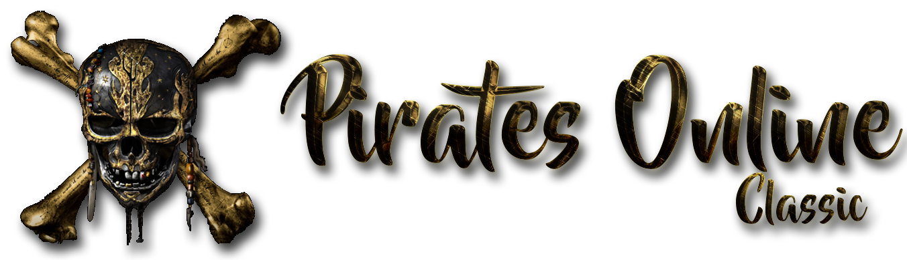

<p align="center">
  
</p>

<h1 align="center">Pirates Online Classic</h1>

<p align="center">
  A fan-made revival of Disney's Pirates of the Caribbean Online, as it played in 2007.
</p>

<p align="center">
  
  
  
</p>

---

Disney shut Pirates of the Caribbean Online down in 2013. This project runs the
original game client against a server rebuilt from scratch: the AI and UberDOG
were reverse-engineered from the client's own code and its network definitions,
and they run on [Astron](https://github.com/Astron/Astron), an open-source
version of the server technology the game was built on.

You can run the whole thing on one computer and play: make a pirate, play the
tutorial, sail, fight, quest and level up.

<p align="center">
  
  
  
</p>
<p align="center"><sub>More in <a href="#screenshots">Screenshots</a>.</sub></p>

## Quick start

You need **Python 3.9+**, **Git**, and the tools to build Astron (**CMake**, a
**C++ compiler** and **Boost**). [docs/setup.md](docs/setup.md) has every step in
detail, including Windows and Linux.

**1. Get the code, with the game resources next to it.**

```bash
git clone https://github.com/PiratesOnlineClassic/pirates-online-classic.git
```

```bash
git clone https://github.com/PiratesOnlineClassic/poc-resources.git resources
```

**2. Install the Python packages** (from inside `pirates-online-classic/`):

```bash
python3 -m pip install -r requirements.txt
```

**3. Build [our Astron fork](https://github.com/PiratesOnlineClassic/Astron)**
and copy the `astrond` binary into `astron/`.

**4. Start the servers in this order**, each in its own terminal, waiting for
each to finish starting:

| | macOS | Linux | Windows |
|---|---|---|---|
| 1. Astron | `astron/darwin/start_astron.command` | `astron/linux/start_astron.sh` | `astron\win32\start_astron.bat` |
| 2. UberDOG | `astron/darwin/start_uberdog.command` | `astron/linux/start_uberdog.sh` | `astron\win32\start_uberdog.bat` |
| 3. AI | `astron/darwin/start_ai.command` | `astron/linux/start_ai.sh` | `astron\win32\start_ai.bat` |
| 4. Game | `darwin/start_game.command` | see [setup](docs/setup.md#starting-by-hand) | `win32\start_dev.bat` |

> [!IMPORTANT]
> Start the UberDOG **before** the AI. If you don't, the AI's district never
> shows up in the shard list.

**5. Log in** with any username; there's no password on a local server. Your
account is created on first login and given full developer access, so every
[magic word](docs/magic-words.md) works.

## Playing

Make a pirate and you start in the tutorial on Rambleshack. You break out of
jail, collect your sea chest from Doggerel Dan, sail with Captain Bo Beck, sink
an undead ship at cannon practice and meet the Jolly Roger, then land in Port
Royal for the main story. [docs/playing.md](docs/playing.md) covers the controls
and walks through the opening quests.

Quick tips:

- Follow the **ray of light** to your active quest.
- **`Tab`** opens your sea chest, **`R`** auto-runs, **`Ctrl`** attacks.
- Type **`~run`**, **`~god`**, **`~gold 10000`** or **`~tp Tortuga`** in chat
  while testing.
- To skip the tutorial while developing, put `skip-tutorial #t` and
  `force-tutorial-complete #t` in `config/personal.prc`.

## Documentation

| | |
|---|---|
| [Setup](docs/setup.md) | Installing, building Astron, starting the servers, ports, where data lives |
| [Playing](docs/playing.md) | Controls, the tutorial, the opening quests, ships |
| [Configuration](docs/configuration.md) | `config/personal.prc` and the settings worth knowing |
| [Magic words](docs/magic-words.md) | Every in-game admin command |
| [Troubleshooting](docs/troubleshooting.md) | Fixes for common problems, and known issues |
| [Architecture](docs/architecture.md) | How the client, Astron, the UberDOG and the AI fit together |
| [Development](docs/development.md) | Code rules, tests, commits, branches, project layout |

## Screenshots

<details>
<summary>Show all 20 screenshots: the tutorial, Port Royal, and the first voyage</summary>
<br>

<table>
<tr>
<td width="50%"><a href="screenshots/Screenshot%202026-11-28%20at%201.26.31%E2%80%AFAM.png"></a><br><sub>Tutorial cannon practice: hit the wreck three times</sub></td>
<td width="50%"><a href="screenshots/Screenshot%202026-11-28%20at%201.26.39%E2%80%AFAM.png"></a><br><sub>The Jolly Roger rises out of the fog</sub></td>
</tr>
<tr>
<td width="50%"><a href="screenshots/Screenshot%202026-11-28%20at%201.26.57%E2%80%AFAM.png"></a><br><sub>The Jolly Roger</sub></td>
<td width="50%"><a href="screenshots/Screenshot%202026-11-28%20at%201.27.01%E2%80%AFAM.png"></a><br><sub>Captain Bo Beck at the wheel</sub></td>
</tr>
<tr>
<td width="50%"><a href="screenshots/Screenshot%202026-11-28%20at%201.27.34%E2%80%AFAM.png"></a><br><sub>The Jolly Roger boards Bo Beck's boat</sub></td>
<td width="50%"><a href="screenshots/Screenshot%202026-11-28%20at%201.27.47%E2%80%AFAM.png"></a><br><sub>The Jolly Roger's cutscene</sub></td>
</tr>
<tr>
<td width="50%"><a href="screenshots/Screenshot%202026-11-28%20at%201.27.53%E2%80%AFAM.png"></a><br><sub>&quot;Sink her! NOW!&quot;</sub></td>
<td width="50%"><a href="screenshots/Screenshot%202026-11-28%20at%201.28.00%E2%80%AFAM.png"></a><br><sub>Escaping the Jolly Roger</sub></td>
</tr>
<tr>
<td width="50%"><a href="screenshots/Screenshot%202026-11-28%20at%201.28.49%E2%80%AFAM.png"></a><br><sub>Port Royal: the ray of light leads to Will Turner's warehouse</sub></td>
<td width="50%"><a href="screenshots/Screenshot%202026-11-28%20at%201.30.23%E2%80%AFAM.png"></a><br><sub>The Port Royal docks</sub></td>
</tr>
<tr>
<td width="50%"><a href="screenshots/Screenshot%202026-11-28%20at%201.30.48%E2%80%AFAM.png"></a><br><sub>Following the ray of light to the dinghy</sub></td>
<td width="50%"><a href="screenshots/Screenshot%202026-11-28%20at%201.30.53%E2%80%AFAM.png"></a><br><sub>Choosing a ship to launch</sub></td>
</tr>
<tr>
<td width="50%"><a href="screenshots/Screenshot%202026-11-28%20at%201.31.13%E2%80%AFAM.png"></a><br><sub>Setting sail from Port Royal</sub></td>
<td width="50%"><a href="screenshots/Screenshot%202026-11-28%20at%201.31.34%E2%80%AFAM.png"></a><br><sub>Manning a cannon at sea</sub></td>
</tr>
<tr>
<td width="50%"><a href="screenshots/Screenshot%202026-11-28%20at%201.31.43%E2%80%AFAM.png"></a><br><sub>Sailing for Devil's Anvil</sub></td>
<td width="50%"><a href="screenshots/Screenshot%202026-11-28%20at%201.31.46%E2%80%AFAM.png"></a><br><sub>Underway, with other ships on the horizon</sub></td>
</tr>
<tr>
<td width="50%"><a href="screenshots/Screenshot%202026-11-28%20at%201.31.53%E2%80%AFAM.png"></a><br><sub>Closing in on Devil's Anvil</sub></td>
<td width="50%"><a href="screenshots/Screenshot%202026-11-28%20at%201.31.58%E2%80%AFAM.png"></a><br><sub>Open water</sub></td>
</tr>
<tr>
<td width="50%"><a href="screenshots/Screenshot%202026-11-28%20at%201.32.24%E2%80%AFAM.png"></a><br><sub>Voyage results after docking</sub></td>
<td width="50%"><a href="screenshots/Screenshot%202026-11-28%20at%201.32.46%E2%80%AFAM.png"></a><br><sub>The ray of light points to Barbossa's cave on Devil's Anvil</sub></td>
</tr>
</table>

</details>

## Contributing

Bug reports and pull requests are welcome. Read [development](docs/development.md)
first. In short: the original client is the spec, new code should read like the
original developers wrote it, and every change comes with a test
(`python3 -m pytest -q`).

- Report bugs and ask for features in [Issues](https://github.com/PiratesOnlineClassic/pirates-online-classic/issues).
- Send changes as [pull requests](https://github.com/PiratesOnlineClassic/pirates-online-classic/pulls).

## Disclaimer

This is a non-commercial fan project made for education and preservation.
Pirates of the Caribbean is a trademark of Disney. This project is not
affiliated with, endorsed by or connected to The Walt Disney Company.
